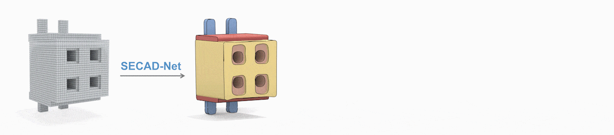

# SECAD-Net

This repository provides the official code of SECAD-Net.

📢: We will release the code for evaluation and the preprocessed Fusion360 dataset later. For detailed information or any inquiries, please contact pli142857@gmail.com.

📢: The current code can only use marching cubes to generate mesh, and the code to generate CAD format is currently a stub function. I have proposed an initial implementation in this [issue discussion](https://github.com/BunnySoCrazy/SECAD-Net/issues/2#issuecomment-1783765741). After thorough testing and validation, I intend to merge this code into the main codebase of the repository. 

## Dependencies

Install python package dependencies:

```bash
$ pip install -r requirements.txt
```


## Dataset

We used the ABC dataset processed by [CAPRI-Net](https://github.com/FENGGENYU/CAPRI-Net), please download it from the link [abc_all.zip](https://drive.google.com/file/d/1DqyZw8zpCiEJMSYp6J6IocMB_IYMwYL1/view) they provided.

## Training & Fine-tuning & Testing

We provide you with basic experiment scripts:

```bash
$ sh scripts/train.sh
$ sh scripts/fine-tuning.sh
$ sh scripts/test.sh
```

## Pre-trained model

Download the pretrained model and the JSON file from this [link](https://drive.google.com/drive/folders/1hLJ6JYI1eXoFG-Qc13Bx3o1s-nt9yHkH?usp=sharing) and put them under `exp_log/`, then run the fine-tuning code.

## Acknowledgement

We would like to thank and acknowledge referenced codes from [CSGStumpNet](https://github.com/kimren227/CSGStumpNet), [CAPRI-Net](https://github.com/FENGGENYU/CAPRI-Net) and [DeepCAD](https://github.com/ChrisWu1997/DeepCAD).
